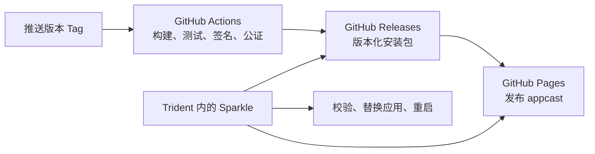

# Trident：Sparkle + GitHub Actions 升级方案

状态：设计方案，尚未接入更新代码或创建 GitHub 发布资源。

## 1. 结论与适用范围

采用 Sparkle 2 管理 macOS 客户端升级，GitHub Actions 自动构建和发布，GitHub Releases 托管安装包，GitHub Pages 托管 appcast 更新清单。客户端运行时访问更新清单和安装包，不调用 GitHub Actions。

当前 Trident 使用 Electron + React，不是 Swift 原生应用。Sparkle 是 macOS 原生框架，需要增加 Objective-C++ / Node-API 桥接模块；electron-builder 自带的发布配置不能完成 Sparkle 接入，也不应同时启用 Electron autoUpdater 或 electron-updater。

建议先支持 Apple Silicon、stable 渠道和完整包更新。原生桥接及重启生命周期验证通过后接入正式发布，再扩展 Intel、beta 和增量更新。暂不重写现有 Electron 界面。

假设通过官网/GitHub 分发，不走 Mac App Store；更新清单和安装包允许公开下载。源码仓库可以保持私有。

## 2. 总体架构



| 组件 | 职责 |
| --- | --- |
| Sparkle.framework | 检查版本、展示更新、下载、校验、安装、重启 |
| 原生桥接模块 | 在 Electron 主进程中调用 Sparkle，将状态和安装请求通知 JS |
| Electron 主进程 | 菜单、更新设置、SSH / SFTP 忙碌状态、退出协调 |
| GitHub Actions | 构建、验证、Apple 签名公证、Sparkle 签名、发布 |
| GitHub Releases | 保存不可变的版本化完整包及发布说明 |
| GitHub Pages | 提供长期固定的 HTTPS appcast 地址 |

## 3. 客户端接入

### 原生桥接

新增 `native/sparkle-bridge/`，使用 Objective-C++ 和 Node-API。只在 Electron 主进程加载，不开放给网页内容直接调用。

首版采用 Sparkle 标准原生更新窗口，使用 `SPUStandardUpdaterController`，减少自定义下载和安装界面的工作量。桥接模块须：

- 在 `app.whenReady()` 后初始化，并将 Sparkle 操作调度到 macOS 主线程。
- 持有 updater/controller/delegate 的生命周期，避免对象被回收。
- 正确处理 Cocoa 与 JS 回调线程，不在 UI 主线程同步等待 JS。
- 提供初始化、手动检查、读取/修改自动检查设置、事件订阅、继续延后的安装等能力。
- 开发模式不启动正式更新；未配置签名/清单的构建禁用检查入口并说明原因。

初始接口草案：

```text
initialize(configuration)
checkForUpdates()
getPreferences()
setAutomaticChecks(enabled)
onStateChanged(callback)
resumePendingInstall()
```

具体接口以桥接验证结果为准；下载、签名验证和安装均交给 Sparkle。

### 应用包布局

```text
Trident.app/Contents/
  Frameworks/Sparkle.framework/
  Resources/app.asar
  Resources/app.asar.unpacked/native/sparkle-bridge.node
  Info.plist
```

原生 `.node` 文件必须位于 ASAR 外。framework 复制必须保留符号链接、可执行权限和内部 helper/XPC 结构，并设置桥接模块正确的 `@rpath`。使用固定 Sparkle 正式版本及校验值，保留对应工具版本与 dSYM。

通过 electron-builder 的打包 hook 在签名前嵌入 framework；通过 `mac.extendInfo` 写入：

- `SUFeedURL`：当前架构与渠道的固定清单地址。
- `SUPublicEDKey`：Sparkle Ed25519 公钥。
- `CFBundleShortVersionString`：展示版本，例如 `0.2.0`。
- `CFBundleVersion`：严格递增的构建版本。

当前 `npmRebuild: false` 仅是现有可选依赖的打包策略。新增 bridge 必须显式针对目标架构与 Electron 工具链构建，不能依赖这个开关自动完成编译。

### 更新交互与会话保护

- 在「Trident」菜单增加「检查更新…」，在设置中提供自动检查开关。
- 首次授权与自动检查遵循 Sparkle 的标准机制，建议保持默认约 24 小时检查间隔。
- 首版不启用无人确认的自动安装；发现更新后由用户选择安装时间。
- 存在 SSH 会话时允许「稍后安装」，或由用户明确选择断开会话并更新。
- 存在 SFTP 传输时默认等待，不自动中断；如用户选择立即退出，明确说明正在传输的文件会中断。
- 安装前停止接受新连接和新传输，等待配置写入完成，再统一关闭会话并继续安装。
- 更新只替换 `.app`，保持 `userData` 路径、连接配置及已信任主机记录不变。

当前代码仅在 `BrowserWindow.close` 中处理会话提示，必须增加主进程级的统一退出协调，避免 Sparkle、菜单退出和窗口关闭分别弹窗或绕过保护。

Sparkle 提供 `updater:shouldPostponeRelaunchForUpdate:untilInvokingBlock:` 延后重启，但官方说明它并非每条安装/退出路径都会调用。不能把它作为唯一保护：必须实际验证 Electron 的 quit / before-quit / Cocoa 终止链路，包括“下载后稍后退出安装”。若标准更新界面无法可靠实现会话保护，该问题是发布阻断项，需调整 user driver 或退出协调设计后再上线。

Electron 渲染器的 `sandbox: true` 与 macOS App Sandbox 是不同机制；不因前者而直接套用 Sparkle 的 App Sandbox 配置。

## 4. 更新分发与版本规则

固定 appcast 地址示例，`OWNER` 和 `trident-updates` 是待确定的占位符：

```text
https://OWNER.github.io/trident-updates/stable/appcast-arm64.xml
https://OWNER.github.io/trident-updates/stable/appcast-x64.xml
https://OWNER.github.io/trident-updates/beta/appcast-arm64.xml
https://OWNER.github.io/trident-updates/beta/appcast-x64.xml
```

首版只创建 `stable/appcast-arm64.xml`。分架构清单避免客户端获取错误架构；beta 的独立清单避免预发布版本进入 stable。清单记录最低 macOS 版本，并保留适量历史条目，服务暂不满足新系统要求的旧设备。

安装包使用版本化地址：

```text
https://github.com/OWNER/trident-updates/releases/download/v0.2.0/Trident-0.2.0-arm64.dmg
```

建议首版统一采用 DMG 供手动安装和 Sparkle 完整更新，内含应用及 `/Applications` 快捷入口。DMG 与应用均签名、公证并 stapling；最终 DMG 再计算 Sparkle 签名。也可采用 ZIP，但启用“解压前验证”后的 EdDSA 换钥恢复机制须重新评估，不能照搬 DMG 流程。

版本规则：

- Tag 与 `package.json.version` 必须一致，首次正式接入建议 `v0.2.0`。
- `CFBundleVersion` 使用全局递增构建号，同次发布各架构使用相同值；重跑复用该发布构建号。
- 不直接使用多个 workflow 各自独立的 `run_number` 作为全局顺序。
- 不覆盖已发布的同版本资产；修复必须发布新版本。
- appcast 的版本信息由最终应用包生成，避免手写元数据与包内版本不一致。
- 生产发布通道做串行化与版本前进校验，防止旧流水线晚完成而覆盖新清单。

私有源码可配公开更新仓库。跨仓库发布需要有目标仓库权限的 GitHub App 安装 token 或细粒度 PAT，源仓库的 `GITHUB_TOKEN` 默认不能跨仓库发布。客户端不内置任何 GitHub token。若安装包必须私有，则另行设计鉴权下载服务。

GitHub Releases 的国内访问速度可能影响下载体验，后续可保留签名体系，将包及清单迁移到自有域名/CDN。升级前应测试现有客户端是否能访问新分发地址。

## 5. GitHub Actions 流程

建议拆为两个 workflow：

| Workflow | 触发条件 | 产出与权限 |
| --- | --- | --- |
| `ci.yml` | PR / 主分支 push | 类型检查、测试、构建；不读取发布私钥，不发布 |
| `release-macos.yml` | `v*` tag；手动重试同一版本 | 签名、公证、发布正式资产和更新清单 |

发布顺序：

1. 检查 Tag、源码版本、发布渠道、构建号与既有 Release 是否匹配。
2. 使用固定 Node、Xcode、Electron、Sparkle 版本执行 `npm ci`、构建与测试。
3. 构建目标架构的 bridge，打包 Electron，嵌入 Sparkle、plist 和公钥。
4. 使用 Developer ID Application 签名 bridge、Sparkle helper/XPC、Electron helper 和外层应用；开启适当 Hardened Runtime，使用必要的最小 entitlements。
5. 使用 `notarytool` 提交应用公证，等待成功并 staple；创建最终 DMG，再完成 DMG 签名、公证和 staple。
6. 对最终、此后不再修改的 DMG 执行 Sparkle 签名。使用 `generate_appcast` 生成/合并清单；首版显式关闭 delta 生成，具体参数以固定版本工具的 help 为准。
7. 检查签名、Gatekeeper、公证票据、版本、架构、包大小、URL 与 XML；生成 SHA256SUMS。
8. 上传至 draft Release；全部目标架构成功后发布 Release。
9. 确认正式下载地址可访问，再发布 Pages 的完整清单目录树；避免单架构或单渠道部署覆盖其他清单。
10. 从公开地址重新读取清单和包，确认新清单实际生效，并验证抽取的 Sparkle 签名信息与本地产物一致。

Feed 发布必须最后进行。Release 成功但 Pages 失败时，可重新执行发布清单步骤，不应重新生成已公开的同版本包。不要仅上传 Actions artifact 作为客户端下载地址，因为它可能过期或需要认证。

Actions 的自动化检查不能替代完整 GUI 升级测试；原生窗口、授权、应用替换与重启需在真实 macOS 用户会话中验收。

## 6. 签名与所需配置

Apple 签名/公证与 Sparkle 签名是两套独立机制：前者服务于 macOS 身份验证和 Gatekeeper，后者验证更新包来自发布者。

| 配置 | 用途 | 保存位置 |
| --- | --- | --- |
| Developer ID Application 证书 `.p12` 及导出密码 | 签名应用、framework/helper 和 DMG | GitHub 发布环境 Secrets |
| Apple API 私钥、Key ID、Issuer ID | 调用 notarization 服务，须具备所需权限 | Secrets / Variables 按敏感程度区分 |
| Sparkle Ed25519 私钥 | 为最终更新包签名 | 发布环境 Secrets；另有离线恢复备份 |
| Sparkle 公钥 | 客户端校验更新包 | 代码中的构建配置及最终 Info.plist |
| Bundle ID、Team ID、feed URL | 固定应用身份与分发入口 | 构建配置 / Variables |
| 仓库发布权限 | 写 Release 与 Pages；跨仓库时写更新仓库 | 最小权限 token 或 GitHub App |

Sparkle 官方 `generate_keys` 生成密钥，采用其支持的导出/导入方式在 CI 临时 keychain 中使用。不要把私钥放入 npm 包、应用、仓库或构建 artifact。发布 job 结束后清理临时 keychain 和私钥文件，不在日志打印秘密。

固定第三方 Actions 的 commit SHA，发布 job 最小化权限；PR 检查和签名发布相互隔离。是否增加发布环境审批由团队发布策略决定，并非 Sparkle 强制要求。

在选定 Sparkle 版本后评估启用 `SUVerifyUpdateBeforeExtraction`。Sparkle 2.9 起可选 `SURequireSignedFeed` 对清单和发布说明签名；若采用，必须同时开启解压前验证，并确保 Pages 原样提供签名后的文件，不能再由站点生成器改写。换钥必须遵循该版本的 key rotation 规则，不能假设丢失私钥后直接换一个公钥即可恢复所有旧客户端。

## 7. 回退与数据兼容

- 网络不可用、清单不合法、签名失败或公证失败：停止升级，现有应用继续使用。
- 已发布版本有问题：移除/修正清单条目以停止后续分发；已经更新的客户端不会因此自动降级。
- 修复或回退代码必须作为更高版本重新发布，例如将上一版稳定代码发布为 `0.2.2`。
- 应用升级不保证自动恢复旧数据结构。为配置增加 schemaVersion，迁移前备份，保留旧字段读取能力，并与代码回退策略一起验收。
- 不删除可能仍被老客户端引用的历史安装包。

## 8. 实施阶段与验收

1. **原生接入验证**：加载 framework、显示检查更新窗口，验证 ARM64 bridge 与主线程回调；完成两份已签名测试构建的真实替换和重启。先解决 Electron/Sparkle 生命周期问题。
2. **客户端保护**：接入菜单和设置，统一退出协调；验证 SSH 在线、文件传输中、取消、稍后退出安装等分支。
3. **发布流水线**：配置 Developer ID、notarization、Ed25519 和公共分发地址，实现 tag 到 DMG/Release/appcast 的流水线。
4. **升级验收**：测试真实旧版到新版、错误签名、断网、只读 DMG/应用未安装、重复点击、多次启动、配置保留和失败恢复。
5. **后续扩展**：Intel 构建及分架构 feed、beta、增量更新、CDN。增量更新必须保持完整包回退，不能替代完整包。

验收必须包含：两次真实安装版本之间升级后版本号变化、可正常连接 SSH、可正常传输文件、连接配置和主机指纹保留，以及活动传输不会被无提示终止。正式签名/公证验收在真实分发包上进行，不通过修改已签名包的 plist 伪造旧版本。

建议新增文件：

```text
native/sparkle-bridge/       Objective-C++ / Node-API 桥
electron/updater.cjs        JS 更新控制与退出协调
build/after-pack.cjs        framework / bridge / plist 注入
build/entitlements.mac.plist
scripts/release/            公证、签名、appcast、公开地址验证
.github/workflows/ci.yml
.github/workflows/release-macos.yml
```

当前 `0.1.0` 没有 Sparkle，不能自行升级到首个含 Sparkle 的版本。需要手动安装一次 `0.2.0`；之后才可通过 Sparkle 升级到 `0.2.1` 等后续版本。首次发布同时固定 Bundle ID 与 userData 路径，测试开发版到发行版的配置迁移，避免应用名称大小写或启动方式变化导致“连接丢失”。

实施前需要确定：最终 Bundle ID、GitHub 仓库/更新仓库、Apple Developer 团队与证书、首版是否仅 ARM64。上述信息不影响先完成本地桥接验证。

## 官方参考

- [Sparkle 接入、签名、公证、appcast](https://sparkle-project.org/documentation/)
- [Sparkle 程序化接入与其他 UI 框架](https://sparkle-project.org/documentation/programmatic-setup)
- [SPUUpdaterDelegate：延后重启及其限制](https://sparkle-project.org/documentation/api-reference/Protocols/SPUUpdaterDelegate.html)
- [发布更新](https://sparkle-project.org/documentation/publishing/)
- [配置与安全选项](https://sparkle-project.org/documentation/customization/)

本文的 Sparkle 接入和生命周期设计依据上述官方文档；bridge 与签名打包细节仍需通过本项目的原型验证。
